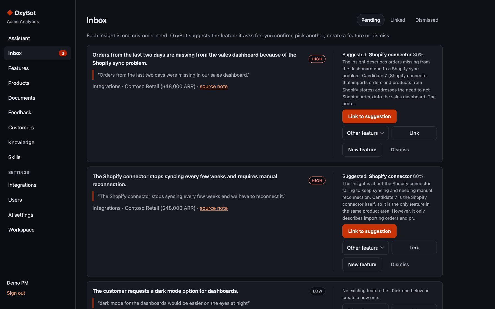
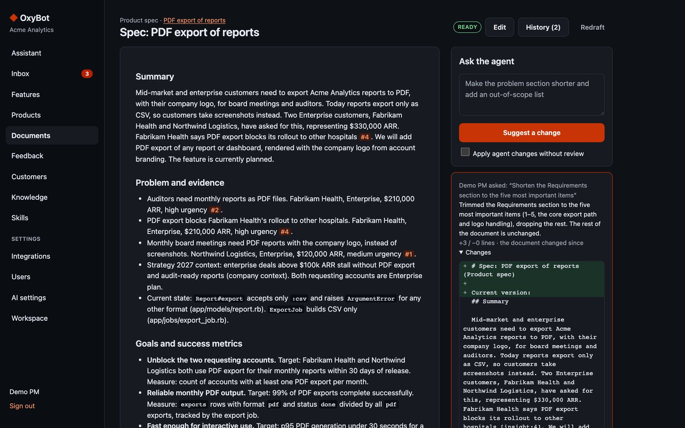

# OxyBot

**An open-source product agent for product teams.** OxyBot collects customer feedback from Slack, Mattermost and
forms, turns it into atomic insights, links them to your backlog, ranks features by how many customers ask and how
much revenue they bring, and drafts specs, reports and release notes with a citation for every claim. You can ask it
questions in the web app, in Slack or in Mattermost, and coding agents read its specs over MCP.

It is a self-hosted alternative to AI product-management agents such as Productboard Spark, built with Ruby on Rails,
Postgres with pgvector, LiteLLM and Langfuse.


## Features

**Feedback to evidence**
- Feedback arrives from Slack and Mattermost feedback channels, a web form and (soon) email.
- A model splits each note into atomic insights, one product each, with urgency and the customer behind it.
- Customers and ARR sync from HubSpot; an insight's customer is found from the author's email or domain.
- Hybrid search (vectors plus full text) and a judge model suggest the backlog feature each insight asks for.
- An inbox where a product manager confirms, relinks, creates a feature or dismisses: the model proposes, people decide.

**Decisions and documents**
- Features ranked by demand: insights, distinct customers and their ARR, each customer counted once.
- Product specs drafted from the feature's evidence, company knowledge and your codebase (GitHub).
- A weekly opportunity report: growth, emerging themes without a feature, segments by plan, roadmap gaps; posted to chat.
- Voice-of-customer reports, release notes with the customers to notify, and launch reviews against the spec's goals.
- Change requests ("shorten the requirements") come back as suggestions with a diff; every edit is a version.
- Templates, team skills (`/churn-risk`) and team or personal instructions encode how your team works.

**Where you work**
- An assistant in the web app, in Slack (DM or mention) and in Mattermost (`/oxybot` or `@oxybot`).
- Features go to Linear as issues with their spec; status syncs both ways.
- An MCP server gives Claude Code, Codex and Cursor read access to specs and customer evidence.

**Built to be trusted**
- Every claim cites the insight it comes from, and code drops any citation the model did not get from a tool.
- Revenue never appears in shared channels; private chats and the web app show it.
- Multi-tenant from the first table: every query is scoped to the account.

| Inbox | Spec with evidence and code context |
|---|---|
|  |  |
| **Features by demand** | **AI settings** |
|  |  |

## How it works

```
 Slack / Mattermost / form ──► FeedbackNote ──► extract (LLM) ──► Insight ──► embed + hybrid search ──► judge (LLM)
                                                                    │                                     │
 HubSpot ──► Customer (ARR) ────────────────────────────────────────┘                    suggested feature │
                                                                                                           ▼
                                                                    PM confirms in the Inbox ──► Feature (demand)
                                                                                                           │
            Assistant (app, Slack, Mattermost) ◄── read-only tools ◄───────────────────────────────────────┤
            Documents: spec, VoC, opportunities, release notes, launch review ◄── facts gathered by code ◄──┤
            Linear (issues, status both ways) · MCP server for coding agents ◄─────────────────────────────┘

 Rails ──► LiteLLM (model aliases, budgets, any provider) ──► Claude, OpenAI, local models
   │            └──► Ollama (local embeddings)
   └──► Langfuse (traces, prompt versions)
```

Code gathers every fact a document uses (counts, ARR, evidence, code hits) and the model only writes. The model
never edits a document in place and has no tool that changes data or reaches outside the app, because feedback is
text written by outsiders.

## Quick start

Requirements: Ruby 4.0, Docker. Everything below runs on your machine.

```bash
git clone <this repository> oxybot && cd oxybot
bundle install
docker compose up -d db
bin/rails db:prepare db:seed
bin/dev
```

Open http://localhost:3120 and sign in as `demo@oxybot.local` (password in `db/seeds.rb`), or create a new
workspace at http://localhost:3120/signup/new.

Without `LITELLM_URL` OxyBot runs on a **built-in mock model** (`lib/mock_llm.rb`): no API keys, every request still
takes the real path through RubyLLM, schemas and tool calls, but answers come from simple heuristics. Integrations
without a token run in **mock mode** too, with a simulator on their page.

### With real models

```bash
cp .env.example .env              # add ANTHROPIC_API_KEY (and OPENAI_API_KEY if you use OpenAI models)
docker compose --profile ai up -d # LiteLLM on :4010, Ollama for embeddings, Langfuse on :3011
bin/rails oxybot:reembed          # once, if you seeded data before switching from the mock
bin/dev
```

Langfuse needs ClickHouse, Redis and S3-compatible storage (all in `compose.yml`) and about 3 GB of memory. To run
without it, start only the model services: `docker compose --profile ai up -d litellm ollama ollama-pull`, and leave
the `LANGFUSE_*` variables empty.

Pick the model for each task in **AI settings**. The default aliases are in `litellm.yaml`; `oxybot-haiku` is a cheap
alias that runs every task on Claude Haiku.

## Configuration

| Variable | Purpose | Default |
|---|---|---|
| `LITELLM_URL`, `LITELLM_API_KEY` | Where Rails sends model calls. Empty: the built-in mock model | mock |
| `ANTHROPIC_API_KEY`, `OPENAI_API_KEY` | Provider keys, read by LiteLLM only | none |
| `OLLAMA_API_BASE` | Embedding server used by the `oxybot-embed` alias | `http://ollama:11434` |
| `LANGFUSE_URL`, `LANGFUSE_PUBLIC_KEY`, `LANGFUSE_SECRET_KEY` | Traces from Rails and prompt management | off |
| `SLACK_SIGNING_SECRET` | Verifies Slack events | local default in development |
| `APP_HOST`, `APP_PROTOCOL` | Links in chat messages and Linear issues | `localhost:3120`, `http` |
| `DB_HOST`, `DB_PORT`, `DB_USER`, `DB_PASSWORD` | Postgres with pgvector | compose database on 5435 |
| `AI_ENABLED` | `false` stops every model call (answers, drafts, extraction) without a deploy | `true` |
| `SENTRY_DSN` | Error and job failure reports to Sentry or a self-hosted GlitchTip | off |
| `SMTP_ADDRESS`, `SMTP_PORT`, `SMTP_USERNAME`, `SMTP_PASSWORD`, `MAILER_FROM` | Outgoing mail (invitations, password resets) | none: links are shown in the app |
| `FORCE_SSL` | HTTPS, HSTS and secure cookies in production | `true` |
| `ALLOW_PRIVATE_INTEGRATION_HOSTS` | Allow a self-hosted Mattermost on a private network address | `false` in production |
| `PRIVACY_POLICY_URL`, `TERMS_URL` | Links shown on sign-in, sign-up and invitation pages | none |
| `CHAT_RETENTION_DAYS` | How long routed chat messages are kept | `90` |

Everything else is set in the dashboard:

| Setting | Where | Who |
|---|---|---|
| Connect, test and disconnect Slack, Mattermost, HubSpot, Linear, GitHub | Integrations | admins |
| Users, roles (admin, member), invitations | Users | admins |
| Model per task, matching and theme thresholds, agent step limit, weekly report schedule and time zone | AI settings | admins |
| Team instructions, document templates | Knowledge, Documents → Templates | admins |
| Products, features, knowledge, skills, personal instructions, chat ids, MCP token | their pages, Profile | everyone |

Model budgets and which provider an alias calls stay in LiteLLM (`litellm.yaml` or its admin UI).

### Prompts

With Langfuse configured, `bin/rails langfuse:push_prompts` uploads `config/prompts/*.txt` as versions labeled
`production`. Edit them in Langfuse; OxyBot uses the new version within 5 minutes ("Reload prompts now" in AI settings
skips the wait) and tags every trace with the prompt version. Without Langfuse, or when it is down, the files are used.

## Integrations

Every integration starts in mock mode until you save its token, and has a **Test connection** button.

- **Slack:** a Slack app with scopes `chat:write`, `app_mentions:read`, `im:history`, `channels:history`, events
  `app_mention`, `message.im`, `message.channels`, the App Home messages tab on, and the request URL `/slack/events`.
  Step-by-step instructions are on the Slack integration page. DM the app for a private, ongoing conversation; mention
  it in a channel for an answer in the thread.
- **Mattermost (self-hosted):** a bot account for replies, outgoing webhooks for feedback channels and for `@oxybot`
  questions (`/mattermost/webhooks`), and a slash command `/oxybot` (`/mattermost/commands`) that works anywhere,
  including direct messages, with an answer only the asker sees. Instructions are on the Mattermost integration page.
- **HubSpot:** a private app token with `crm.objects.companies.read` and `crm.objects.contacts.read`. Choose the
  company property that holds ARR. Syncs every hour.
- **Linear:** a personal API key, the team id, and a webhook (Issues) to `/linear/webhooks` with its signing secret.
- **GitHub:** a fine-grained, read-only token for the repository; the spec writer searches it for technical context.
- **Coding agents (MCP):** create a token on your profile, then
  `claude mcp add --transport http oxybot https://your-host/mcp --header "Authorization: Bearer <token>"`.
  Tools: `list_specs`, `get_spec`, `search_feedback`.

## Security model

- **Limits:** sign-in and password resets are limited per address and per email; model-backed actions (questions,
  drafts, change requests, feedback) are limited per user per minute; MCP per token. The values are defaults in the
  controllers; LiteLLM's daily budgets cap the total spend.
- **Sessions** end after 14 days without use or 30 days after sign-in; a password reset ends all sessions and revokes
  the MCP token.
- **Chat identities** (Slack and Mattermost ids) are set by admins, and Slack events reach a workspace only after
  "Test connection" confirmed its team id, so nobody can claim someone else's messages or workspace.
- **Outbound calls** have timeouts; integration URLs that point to private or local addresses are refused in
  production (server-side request forgery).
- **Privacy:** workspace export (JSON) and deletion, deletion of feedback and customers, daily purge of ended
  sessions and old chat messages, no contact emails sent to the model, and LiteLLM traces without message text.

- **Tenancy:** every table carries `account_id`; controllers start from `Current.account`, jobs and webhooks from the
  record's account, and agent tools are built per request for one account.
- **Untrusted text:** feedback and chat messages are data. The extraction model has no tools, the assistant's tools
  only read, and model output is validated (unknown products, features outside the candidates and invented citations
  are dropped).
- **Webhooks** are verified: Slack and Linear signatures with replay windows, Mattermost tokens, and slash command
  callbacks only to your own Mattermost server.
- **Secrets:** integration tokens are encrypted at rest (Active Record Encryption); MCP tokens and invitation links
  are stored as SHA-256 digests and shown once.
- **Roles:** only admins change integrations, users, AI settings and team-wide instructions.

Found a vulnerability? See [SECURITY.md](SECURITY.md).

## Development

```bash
bin/rails test     # offline: model, Slack, Mattermost, HubSpot, Linear and GitHub calls are stubbed
bin/rubocop
bin/brakeman
```

The code follows Rails conventions: logic lives in models and concerns (`Insight::Matchable`,
`Feature::Deliverable`), plain Ruby objects sit next to their model (`Document::Brief`, `Conversation::Turn`), jobs
only call a model method, and there are no service objects. Agents (`app/agents`) are RubyLLM agents; their tools are
in `app/tools`.

| Path | What is there |
|---|---|
| `app/models/feedback_note`, `insight`, `feature` | Extraction, matching, demand, delivery to Linear |
| `app/models/document*` | Briefs, generation, revisions, diffs, versions |
| `app/models/integration*`, `chat_message.rb` | Slack, Mattermost, HubSpot, Linear, GitHub adapters |
| `app/models/conversation*`, `app/tools` | The assistant and its read-only tools |
| `app/tools/spec_server` | MCP tools for coding agents |
| `config/prompts` | Prompt fallbacks (Langfuse text-prompt format) |
| `lib/mock_llm.rb` | The offline model used in development and tests |

## Roadmap

- Real-time co-editing of documents between people
- Analytics connectors (Amplitude, Pendo) for launch reviews; today they read `config/mocks/usage.yml`
- Email and support-tool sources (Intercom, Zendesk, Gong)
- Competitive research from public sources

## Contributing

Issues and pull requests are welcome; see [CONTRIBUTING.md](CONTRIBUTING.md).

## License

Not chosen yet. Until a license file is added, all rights are reserved by the author.
